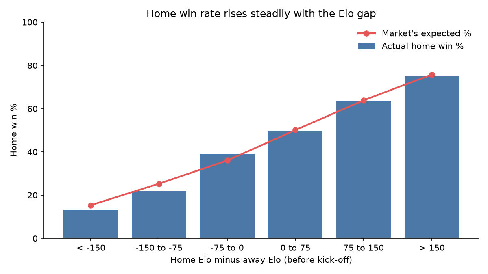

# ⚽ Premier League Match Forecasting: Can a Model Beat the Betting Market?

An end-to-end data project: an automated pipeline collects Premier League results and
bookmaker odds, a machine learning model forecasts match outcomes, and a live dashboard
compares the model's probabilities against the market to find mispriced matches.

> Status: **Phase 3 complete** (feature engineering). Next: the forecasting model.

## Why this project
Bookmakers price football matches the way traders price stocks. This project combines
**football analytics**, **probability and risk thinking (finance)**, and a **fan-facing
product (entertainment)**.

## Project roadmap

| Phase | What | Skills shown | Status |
|---|---|---|---|
| 1. Data pipeline | Download 6 seasons of EPL results + odds into a SQL database | Python, SQL, data cleaning | ✅ |
| 2. Exploration | SQL analysis: home advantage, bookmaker accuracy and margin, market expectations | SQL, EDA | ✅ |
| 3. Features | Rolling form, goals, shots on target, Elo ratings, rest days, market probabilities | Feature engineering, leakage testing | ✅ |
| 4. Model | Predict Home/Draw/Away probabilities (logistic regression → XGBoost) | ML, probability calibration | ⬜ |
| 5. Betting backtest | Compare model vs. bookmaker odds, simulate a betting strategy, track ROI | Finance thinking, statistics | ⬜ |
| 6. Automation | GitHub Actions runs the pipeline + predictions every day | MLOps, scheduling | ⬜ |
| 7. Dashboard | Streamlit app: upcoming fixtures, predictions, model track record | Deployment, storytelling | ⬜ |

## Key findings (Phase 2)
Based on 1,990 Premier League matches, 2021-22 to 2026-27 (season in progress).
Queries: [`sql/02_exploration.sql`](sql/02_exploration.sql).

| Question | Finding |
|---|---|
| **Is home advantage stable?** | Home teams win 40–48% of matches. It peaked in 2022-23 (48.4%) and has been lower since, while draws rose from ~22% to ~27%. |
| **Are bookmakers accurate?** | Yes. Across probability bands, predicted and actual home-win rates are close, but predicted is usually a few points higher, a sign of the built-in margin. |
| **How big is the bookmaker margin?** | Flat at 4.1% from 2021-22 to 2023-24, then rising every season to 6.3% in 2026-27: a ~50% bigger cut for bookmakers. A model has to beat this to profit. |
| **Which teams beat the market?** | In 2025-26 home games, Fulham won 11 vs. 7.3 expected (+3.7); Tottenham won 3 vs. 8.1 expected (−5.1). Possible "reputation bias" toward big clubs, to be tested across seasons. |
| **What were the biggest upsets?** | Nott'm Forest 1–0 Liverpool (2022-23), with Forest given just 8.8%. Liverpool were on the losing side of 4 of the 10 biggest home upsets, and all 10 came against big clubs. |

**Takeaway:** the betting market is well calibrated overall, but its margin is growing and
there are hints that it overrates big clubs. Phase 4–5 test whether a model can exploit that.

## Features (Phase 3)
Every match gets 34 columns built from information known **before kick-off**
([`src/features.py`](src/features.py), walkthrough in
[`notebooks/03_features.ipynb`](notebooks/03_features.ipynb)).

| Feature | How it's built |
|---|---|
| **Form** | Average points over each team's last 5 matches |
| **Attack / defence** | Average goals scored and conceded over the last 5 |
| **Shots on target** | Average for and against over the last 5 |
| **Elo rating** | Team strength updated after every result (home advantage 60 points, promoted teams start at 1450) |
| **Rest days** | Days since each team's previous match |
| **Market probability** | Bookmaker odds converted to probabilities with the margin removed |

**No data leakage:** a test changes one match's score to 0–9, rebuilds every feature and
confirms that match's features are unchanged while later matches update.



- The market is the strongest single signal (correlation 0.40 with a home win), then Elo (0.35).
- Shots on target are a better form signal than goals (0.26 vs 0.22): shots are less driven by luck.
- Rest days barely matter in the Premier League (−0.03).

## Data source
[football-data.co.uk](https://www.football-data.co.uk/): free match results, stats
(shots, corners, cards, xG) and odds from major bookmakers, updated twice a week.

## How to run

```bash
python3 -m venv .venv
source .venv/bin/activate
pip install -r requirements.txt
python src/ingest.py
python src/features.py
```

This creates `data/football.db`, a SQLite database. Open it in **DBeaver**:
*New Database Connection → SQLite → Path: `data/football.db`*.

## Project structure
```
premier-league-match-forecasting/
├── data/            # SQLite database (generated)
├── images/          # charts used in this README
├── notebooks/
│   └── 03_features.ipynb   # Phase 3: feature walkthrough + leakage test
├── sql/
│   └── 02_exploration.sql  # Phase 2: SQL analysis + findings
├── src/
│   ├── ingest.py    # Phase 1: download + load match data
│   └── features.py  # Phase 3: build pre-match features
├── requirements.txt
└── README.md
```
