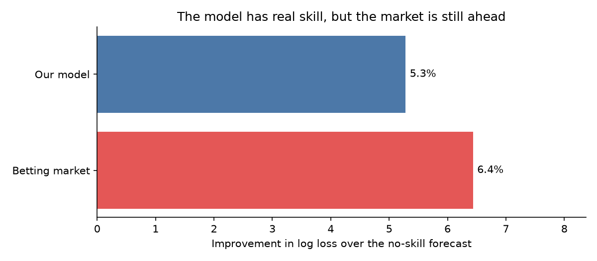
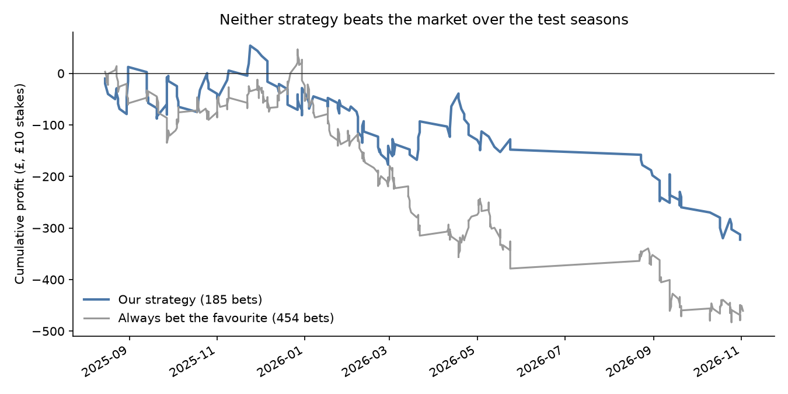

# ⚽ Premier League Match Forecasting: Can a Model Beat the Betting Market?

[](https://github.com/thelastjedi001/premier-league-match-forecasting/actions/workflows/tests.yml)
[](https://github.com/thelastjedi001/premier-league-match-forecasting/actions/workflows/weekly-update.yml)

An end-to-end data project: an automated pipeline collects Premier League results and
bookmaker odds, a machine learning model forecasts match outcomes, and the forecasts are
compared with the betting market every week.

> Status: **Phases 1–6 complete**, now updating itself every Friday. Next: a live dashboard.
>
> Figures in this README are a snapshot of results up to 2 November 2026. The latest
> numbers are in [`outputs/model_performance.json`](outputs/model_performance.json) and
> next week's forecasts in [`outputs/upcoming_predictions.csv`](outputs/upcoming_predictions.csv).

**The answer, so far: no.** A model built on team form and strength forecasts matches
almost as well as the bookmakers, but betting on its disagreements with the market lost
17% over 185 bets, and a luck test finds no evidence of an edge. The market is hard to
beat with public data alone. [Jump to the backtest](#betting-backtest-phase-5).

## Why this project
Bookmakers price football matches the way traders price stocks. This project combines
**football analytics**, **probability and risk thinking (finance)**, and a **fan-facing
product (entertainment)**.

## Project roadmap

| Phase | What | Skills shown | Status |
|---|---|---|---|
| 1. Data pipeline | Download 6 seasons of EPL results + odds into a SQL database | Python, SQL, data cleaning | ✅ |
| 2. Exploration | SQL analysis: home advantage, bookmaker accuracy and margin, market expectations | SQL, EDA | ✅ |
| 3. Features | Rolling form, goals, shots on target, Elo ratings, rest days, market probabilities | Feature engineering, leakage testing | ✅ |
| 4. Model | Forecast Home/Draw/Away probabilities; compare logistic regression and gradient boosting against the market | ML, time-based validation, calibration | ✅ |
| 5. Betting backtest | Bet on model-vs-market disagreements, track ROI, test for luck with simulation | Finance thinking, statistics | ✅ |
| 6. Automation | GitHub Actions runs unit tests and the full pipeline weekly, forecasts upcoming fixtures and commits the results | CI/CD, testing, scheduling | ✅ |
| 7. Dashboard | Streamlit app: upcoming fixtures, predictions, model track record | Deployment, storytelling | ⬜ |

## Key findings (Phase 2)
Based on 1,990 Premier League matches, 2021-22 to 2026-27 (season in progress).
Queries: [`sql/02_exploration.sql`](sql/02_exploration.sql).

| Question | Finding |
|---|---|
| **Is home advantage stable?** | Home teams win 40–48% of matches. It peaked in 2022-23 (48.4%) and has been lower since, while draws rose from ~22% to ~27%. |
| **Are bookmakers accurate?** | Yes. Across probability bands, predicted and actual home-win rates are close, but predicted is usually a few points higher, a sign of the built-in margin. |
| **How big is the bookmaker margin?** | Flat at 4.1% from 2021-22 to 2023-24, then rising every season to 6.3% in 2026-27: a ~50% bigger cut for bookmakers. A model has to beat this to profit. |
| **Which teams beat the market?** | In 2025-26 home games, Fulham won 11 vs. 7.3 expected (+3.7); Tottenham won 3 vs. 8.1 expected (−5.1). Possible "reputation bias" toward big clubs, to be tested across seasons. |
| **What were the biggest upsets?** | Nott'm Forest 1–0 Liverpool (2022-23), with Forest given just 8.8%. Liverpool were on the losing side of 4 of the 10 biggest home upsets, and all 10 came against big clubs. |

**Takeaway:** the betting market is well calibrated overall, but its margin is growing and
there are hints that it overrates big clubs. Phase 4–5 test whether a model can exploit that.

## Features (Phase 3)
Every match gets 34 columns built from information known **before kick-off**
([`src/features.py`](src/features.py), walkthrough in
[`notebooks/03_features.ipynb`](notebooks/03_features.ipynb)).

| Feature | How it's built |
|---|---|
| **Form** | Average points over each team's last 5 matches |
| **Attack / defence** | Average goals scored and conceded over the last 5 |
| **Shots on target** | Average for and against over the last 5 |
| **Elo rating** | Team strength updated after every result (home advantage 60 points, promoted teams start at 1450) |
| **Rest days** | Days since each team's previous match |
| **Market probability** | Bookmaker odds converted to probabilities with the margin removed |

**No data leakage:** a test changes one match's score to 0–9, rebuilds every feature and
confirms that match's features are unchanged while later matches update.


- The market is the strongest single signal (correlation 0.40 with a home win), then Elo (0.35).
- Shots on target are a better form signal than goals (0.26 vs 0.22): shots are less driven by luck.
- Rest days barely matter in the Premier League (−0.03).

## Model results (Phase 4)
A logistic regression forecasts home / draw / away probabilities from 8 features. It
**never sees the odds**, so it's a fair challenger to the market
([`src/model.py`](src/model.py), walkthrough in [`notebooks/04_model.ipynb`](notebooks/04_model.ipynb)).

Seasons are split by time: train 2021-24, choose the model on 2024-25, and test once on
2025-26 and 2026-27 (454 matches).

| Forecast | Log loss ↓ | Brier ↓ | Accuracy ↑ |
|---|---|---|---|
| Base rates (no skill) | 1.092 | 0.661 | 41.0% |
| **Our model** | **1.034** | **0.622** | **47.6%** |
| Betting market | 1.022 | 0.614 | 48.9% |



- **The model has real skill** but the market is still slightly ahead, as expected given
  bookmakers' access to team news and betting flows.
- **Simple beats complex:** logistic regression beat gradient boosting on validation; with
  ~1,100 training matches, the flexible model fit noise.
- **Biggest weakness:** home advantage fell after the training years (46% → ~41% home wins),
  so the model slightly over-rates home teams ([calibration chart](images/calibration.png)).
- **Largest disagreements involve Chelsea and Tottenham,** where the model rates them well
  below the market: the same "reputation bias" hint as Phase 2. Phase 5 tests whether
  betting on these disagreements makes money.

## Betting backtest (Phase 5)
**Rule:** bet £10 on any outcome where `model probability × average odds − 1` beats a
minimum edge. The threshold (15%) was chosen on the 2024-25 validation season, then applied
once to the test seasons ([`src/backtest.py`](src/backtest.py), walkthrough in
[`notebooks/05_backtest.ipynb`](notebooks/05_backtest.ipynb)).

| Strategy (2025-26 to 2026-27) | Bets | Win rate | Profit | ROI |
|---|---|---|---|---|
| Always bet home | 454 | 41.0% | −£580 | −12.8% |
| Always bet the market favourite | 454 | 48.9% | −£461 | −10.1% |
| **Our strategy** | **185** | **23.8%** | **−£323** | **−17.4%** |



- **Luck test:** replaying the same bets 10,000 times with results drawn from the market's
  probabilities, 82% of simulations did at least as well. No evidence of skill.
- **Adverse selection:** the model expected +31% ROI on these bets and the market implied
  −5.6%; reality was −17%. The biggest disagreements with the market are where the model is
  most likely to be wrong, because the market knows things it doesn't (injuries, team news).
- **Home bets lost 34%:** the model learned when home teams won 46% of matches, but in the
  test seasons they won about 41%.
- **Reputation bias didn't hold up:** bets against the big six lost as much as other bets.
- **No cherry-picking:** a 0% threshold would have shown +2.2% on the test, but validation
  pointed to 15% and results swing wildly between thresholds.

**What could give a real edge:** team news and line-ups, blending the model with market
prices, retraining weekly, and betting at the best available odds rather than the average.

## Automation (Phase 6)
Every Friday at 09:00 UTC a [GitHub Actions workflow](.github/workflows/weekly-update.yml):

1. runs the unit tests and stops if any fail
2. runs [`src/pipeline.py`](src/pipeline.py): downloads the latest results, rebuilds features,
   retrains and re-tests the model, and re-runs the backtest
3. forecasts the next round of fixtures with [`src/predict.py`](src/predict.py)
4. commits the refreshed [`outputs/`](outputs/) back to this repository

New seasons are picked up automatically each August. A [second workflow](.github/workflows/tests.yml)
runs the tests on every push.

**Tests** ([`tests/test_pipeline.py`](tests/test_pipeline.py)) use small made-up seasons, so
they run in about a second without downloading anything. They check that rolling form uses only
earlier matches, that a match's own result never leaks into its features, that upcoming
fixtures get features, that market probabilities sum to 1, that log loss reads the outcome
columns in the right order, and that seasons roll over in August. Removing the `shift(1)` that
prevents leakage makes two of them fail.

## Data source
[football-data.co.uk](https://www.football-data.co.uk/): free match results, stats
(shots, corners, cards, xG) and odds from major bookmakers, updated twice a week.

## How to run

```bash
python3 -m venv .venv
source .venv/bin/activate
pip install -r requirements.txt
python -m pytest            # unit tests
python src/pipeline.py      # the whole project, start to finish (~10 seconds)
```

Each step can also run on its own: `src/ingest.py`, `src/features.py`, `src/model.py`,
`src/backtest.py`, `src/predict.py`.

This creates `data/football.db`, a SQLite database. Open it in **DBeaver**:
*New Database Connection → SQLite → Path: `data/football.db`*.

## Project structure
```
premier-league-match-forecasting/
├── .github/workflows/
│   ├── tests.yml           # run the tests on every push
│   └── weekly-update.yml   # Phase 6: weekly pipeline run
├── data/            # SQLite database (generated)
├── images/          # charts used in this README
├── notebooks/
│   ├── 03_features.ipynb   # Phase 3: feature walkthrough + leakage test
│   ├── 04_model.ipynb      # Phase 4: model selection, test vs market, calibration
│   └── 05_backtest.ipynb   # Phase 5: betting backtest, luck test, breakdowns
├── outputs/         # refreshed weekly by GitHub Actions
│   ├── model_performance.json
│   └── upcoming_predictions.csv
├── sql/
│   └── 02_exploration.sql  # Phase 2: SQL analysis + findings
├── src/
│   ├── ingest.py    # Phase 1: download + load match data
│   ├── features.py  # Phase 3: build pre-match features
│   ├── model.py     # Phase 4: train, select and test the model
│   ├── backtest.py  # Phase 5: betting strategy, ROI and luck test
│   ├── predict.py   # Phase 6: forecast upcoming fixtures
│   └── pipeline.py  # Phase 6: run everything in order
├── tests/
│   └── test_pipeline.py    # unit tests
├── pytest.ini
├── requirements.txt
└── README.md
```
